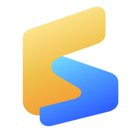

<p align="center">
  
</p>

<h1 align="center">Voxiva Space</h1>

<p align="center">
  A desktop workspace for terminals, coding agents, files, and Chromium browser previews.
</p>

<p align="center">
  <a href="README.md">English</a> ·
  <a href="README.ru.md">Русский</a> ·
  <a href="README.zh-CN.md">简体中文</a>
</p>

<p align="center">
  <a href="https://github.com/voxiva-ai/voxiva-space/actions/workflows/ci.yml"></a>
  <a href="https://github.com/voxiva-ai/voxiva-space/releases"></a>
  
  <a href="LICENSE"></a>
</p>

> **Beta v0.2.4.** Voxiva Space is usable today, but the interface and session model are still evolving.

## One window for the whole agent workflow

Run Claude Code, Codex, OpenCode, Gemini CLI, Aider, Amp, Goose, Cursor Agent, or any other terminal tool without losing track of the work around it. Voxiva Space keeps terminals, files, browser previews, tasks, and agent attention in one resizable desktop workspace.

### Highlights

- **Terminal-native agents** — launch installed agent CLIs from the Vault or use any command in a normal shell.
- **Splits and tabs** — arrange horizontal and vertical panes, maximize one pane, then restore the full layout.
- **Correct full-screen TUIs** — xterm and ConPTY sizes stay synchronized so Claude Code and OpenCode reflow with the pane instead of clipping.
- **Files beside the terminal** — browse the current workspace and open supported media directly in a pane.
- **Built-in browser** — keep a local preview next to the agent that is editing it.
- **Attention tracking** — panes and workspace tabs surface agents waiting for input.
- **Session continuity** — restore layouts and resume supported agent conversations after relaunch.
- **Keyboard-first control** — command palette, customizable shortcuts, zoom, drag-and-drop, and pane navigation.
- **Local by default** — no Voxiva account and no telemetry in this beta.

## Install

### Latest Windows build

Download and run the newest `*-setup.exe` from [GitHub Releases](https://github.com/voxiva-ai/voxiva-space/releases).

Or install/update from PowerShell:

```powershell
irm https://raw.githubusercontent.com/voxiva-ai/voxiva-space/main/scripts/tester-install.ps1 | iex
```

If you prefer to inspect scripts before running them, open [`scripts/tester-install.ps1`](scripts/tester-install.ps1), download it, and run it locally.

Requirements: Windows 10/11 or macOS 13+. The installer uses the Chromium runtime bundled with Electron; it does not require WebView2. On Windows, installation is per-user; managed PCs may still ask for elevation.

### Uninstall

Open **Windows Settings → Apps → Installed apps → Voxiva Space → Uninstall**.

## Quick start

1. Open Voxiva Space and choose a project folder.
2. Pick a one-, two-, four-, or eight-pane layout.
3. Open **Agents** and launch any CLI detected on your `PATH`.
4. Split terminals, open a browser pane, or drag files into an agent prompt as `@paths`.

Voxiva Space does not install or authenticate third-party agents for you. Install each CLI from its official source and sign in there once.

## Default shortcuts

All shortcuts are editable in **Settings → Keyboard shortcuts**.

| Action | Shortcut |
| --- | --- |
| New terminal tab | `Ctrl+T` |
| Close tab | `Ctrl+W` |
| Reopen closed tab | `Ctrl+Shift+T` |
| Split right | `Ctrl+D` |
| Split down | `Alt+F` |
| Maximize pane | `Ctrl+Shift+Enter` |
| Focus previous / next pane | `Alt+J` / `Alt+K` |
| Focus browser address bar | `Ctrl+L` |
| Jump to latest attention | `Ctrl+Shift+U` |
| New space | `Ctrl+N` |
| Next / previous space | `Alt+1` / `Alt+Shift+1` |
| Zoom | `Ctrl++` / `Ctrl+-` / `Ctrl+0` |

## Build from source

Prerequisites:

- Node.js 20+
- Rust stable with the MSVC toolchain
- Visual Studio Build Tools with Desktop development with C++
- On macOS: Xcode Command Line Tools

```powershell
git clone https://github.com/voxiva-ai/voxiva-space.git
cd voxiva-space
npm ci
npm run dev
```

Checks and Electron release bundle:

```powershell
npm run electron:check
npm run electron:dist
```

Installers are written to `release/`. `npm run dev` builds the React UI and Rust PTY backend, then launches the Electron app.

## Project map

| Path | Purpose |
| --- | --- |
| `src/` | React UI, workspaces, agents, terminal, browser, themes |
| `electron/` | Electron main process, secure preload bridge, Chromium browser views, updates, and app status |
| `native/` | Rust PTY and local-system backend used by Electron |
| `scripts/` | Development, release, theme, and installer helpers |
| `.github/workflows/` | CI and tagged release automation |

## Privacy

Workspace layouts and preferences stay on this PC. The app does not include telemetry. Update checks request release metadata from GitHub (with a Voxiva endpoint fallback), and the optional phone companion stays on the local network.

## Contributing

Bug reports and focused pull requests are welcome. Read [CONTRIBUTING.md](CONTRIBUTING.md) before opening a change.

## License

[MIT](LICENSE) © 2026 Voxiva AI contributors.
